# Lab 07 — Active Directory RBAC & File Share Access Monitoring

## Objective

Implement Role-Based Access Control (RBAC) in an Active Directory environment, enforce least-privilege access to departmental file shares, and investigate unauthorized access attempts using Windows Security logs and Wazuh SIEM.

This exercise demonstrates access-control administration, security auditing, SIEM troubleshooting, and evidence-based investigation in a controlled home lab.

## Lab Environment

| Component | Configuration |
|---|---|
| Virtualization | VMware Workstation Pro |
| Domain Controller | Windows Server 2022 |
| Active Directory Domain | `corp.example.test` |
| Server Hostname | `AD-DC01` |
| SIEM | Wazuh |
| Windows Wazuh Agent | Agent ID `004` |
| Monitored Event | Windows Security Event ID `5145` |

## 1. Active Directory and RBAC Configuration

Created departmental Organizational Units (OUs) to organize users according to their business functions:

- IT
- HR
- Finance

Configured departmental security groups to manage access through group membership rather than assigning permissions individually.

Example accounts used during testing:

| User | Department | Access requirement |
|---|---|---|
| Anna Reyes | HR | Authorized access to HR resources |
| Mark Santos | Finance | Authorized access to Finance resources |

**Security principle:** Group-based permissions simplify administration and help enforce the Principle of Least Privilege.

A user's access should be determined by their responsibilities and approved business requirements.

## 2. Departmental File Share Configuration

Created departmental folders under:

`C:\DepartmentShares\`

Configured NTFS permissions and SMB share permissions for the HR and Finance folders.

### HR Share

- Share name: `HR`
- Path: `C:\DepartmentShares\HR`
- HR STAFF: Modify (NTFS), Change (SMB share)
- Domain Admins: Full Control

### Finance Share

- Share name: `Finance`
- Path: `C:\DepartmentShares\Finance`
- Finance-staff: Modify (NTFS), Change (SMB share)
- Domain Admins: Full Control

Removed broad access entries from the departmental folder permissions and share permissions to restrict access to authorized groups.

Verified SMB share paths and permissions using:

```cmd
net share HR
net share Finance
```

### Configuration Troubleshooting

During initial testing, the HR share incorrectly pointed to:

`C:\DepartmentShares`

Instead of:

`C:\DepartmentShares\HR`

This caused the share to display the parent directory containing multiple departmental folders.

The incorrect share was removed and recreated using the intended HR folder path.

**Lesson learned:** Always verify the actual resource path and permissions after configuring a network share. A successful connection does not necessarily prove that the configuration is correct.

## 3. Effective Access Verification

Used Windows **Advanced Security Settings → Effective Access** to evaluate departmental permissions.

### Authorized User — Anna Reyes

The Effective Access evaluation showed that Anna had the permissions needed to work with the HR folder without Full Control.

### Restricted User — Mark Santos

The Effective Access evaluation showed that Mark did not have the permissions required to read, modify, or manage the HR folder.

These results were consistent with the intended departmental access restrictions.

**Note:** Effective Access evaluates permissions; it does not itself generate an actual access-denied event.

## 4. Unauthorized Access Test

Performed a controlled attempt to access the Finance share using Anna's network credentials.

The test used:

```cmd
runas /netonly /user:CORP\anna cmd
```

Followed by:

```cmd
dir \\AD-DC01\Finance
```

**Observed result:**

```text
Access is denied.
```

Because `/netonly` retains the local process identity while supplying different credentials for network authentication, the Windows Security logs were examined to confirm which account performed the access attempt.

## 5. Windows Security Auditing

Initially, no Event ID 5145 entries appeared in Event Viewer.

Checked the auditing configuration:

```cmd
auditpol /get /subcategory:"Detailed File Share"
```

**Initial result:** `No Auditing`

Enabled successful and failed detailed file-share auditing:

```cmd
auditpol /set /subcategory:"Detailed File Share" /success:enable /failure:enable
```

Verified the updated setting:

`Detailed File Share — Success and Failure`

Repeated the access attempt and confirmed that Windows generated Event ID **5145 — Detailed File Share**, marked as an audit failure.

### Windows Event 5145 Findings

| Field | Observed value |
|---|---|
| Account | `CORP\anna` |
| Target share | `\\*\Finance` |
| Share path | `C:\DepartmentShares\Finance` |
| Relative target | `\` (share root) |
| Access mask | `0x100080` |
| Requested permissions | SYNCHRONIZE, ReadAttributes |
| Access check | Both permissions not granted |
| Audit result | Failure |

The Windows event identified `CORP\anna` as the network account, despite `whoami` in the `runas /netonly` Command Prompt reporting the local identity `CORP\administrator`.

## 6. Wazuh SIEM Investigation

Verified that the Wazuh Manager was running and the domain controller's agent was connected:

```bash
sudo systemctl status wazuh-manager
sudo /var/ossec/bin/agent_control -l
```

The agent appeared as `004 — AD-DC01 — Active`. However, the initial Threat Hunting search for `data.win.system.eventID: "5145"` returned no matching alerts.

### Troubleshooting the Monitoring Gap

Checked raw-event archiving in the Wazuh Manager configuration:

```xml
<logall>no</logall>
<logall_json>no</logall_json>
```

Because raw-event archiving was disabled, the absence of a match in `archives.json` could not establish whether the manager had received Event 5145.

Inspected the Windows agent's `C:\Program Files (x86)\ossec-agent\ossec.conf` Security event-channel query and found an exclusion:

```text
EventID != 5145
```

Backed up the configuration, removed **only** the Event 5145 exclusion while preserving the other filters, and restarted the Windows agent:

```powershell
Restart-Service -Name WazuhSvc
Get-Service -Name WazuhSvc
```

The agent returned to the Running state. A fresh controlled Finance-share access attempt was then generated.

## 7. Wazuh Detection Verified

Wazuh Threat Hunting subsequently displayed an alert for the expected Windows Security event.

| Field | Verified finding |
|---|---|
| Agent | `AD-DC01` |
| Agent ID | `004` |
| Windows Event ID | `5145` |
| Account | `CORP\anna` |
| Share | Finance |
| Audit result | `AUDIT_FAILURE` |
| Wazuh rule ID | `60104` |
| Rule description | Windows audit failure event |
| Rule level | `5` |

The expanded Wazuh event contained the account, Finance share path, Event ID 5145, and audit-failure status. This confirmed that the revised collection configuration allowed the event to reach Wazuh and match an existing alert rule.

**Detection limitation:** Rule 60104 is a general Windows audit-failure rule, not a custom Finance-share access rule.

## 8. Analyst Assessment

**Finding:** An HR account attempted to access the Finance share without the required permissions.

**Access-control outcome:** Windows denied the requested access, consistent with the configured departmental permissions.

**Monitoring outcome:** Event 5145 was recorded locally and subsequently visible as a Wazuh alert after the collection filter was corrected.

**Disposition:** Authorized, controlled home-lab test. This was not a production security incident. In a real SOC, business justification, user activity, frequency, and surrounding authentication events would need to be evaluated before escalation.

## 9. Lessons Learned

1. RBAC and least privilege are easier to manage through departmental security groups.
2. NTFS and SMB permissions must both be validated; an incorrect share path can expose unintended directory names.
3. Effective Access calculations are useful but do not replace real access tests.
4. Windows auditing must be enabled to generate the desired security events.
5. A connected Wazuh agent does not guarantee every event is collected.
6. Event filters can suppress important evidence before it reaches the SIEM.
7. Raw-event archiving, alert generation, and incident classification are distinct concepts.
8. A security alert requires context before it can be classified as an incident.

## 10. Evidence Screenshots

The following screenshots were captured during the controlled lab and are stored in [the Lab 07 evidence folder](07-evidence/).

### Active Directory structure and permissions

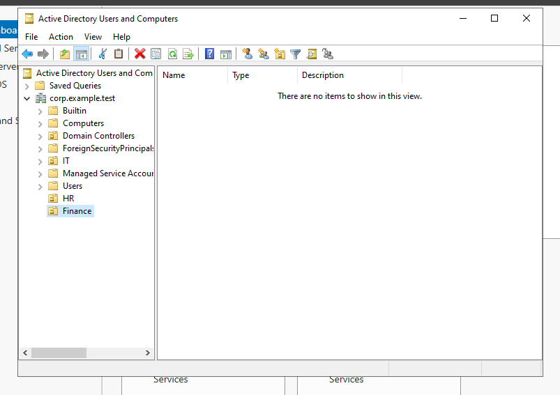
*Figure 1 — IT, HR, and Finance organizational units.*

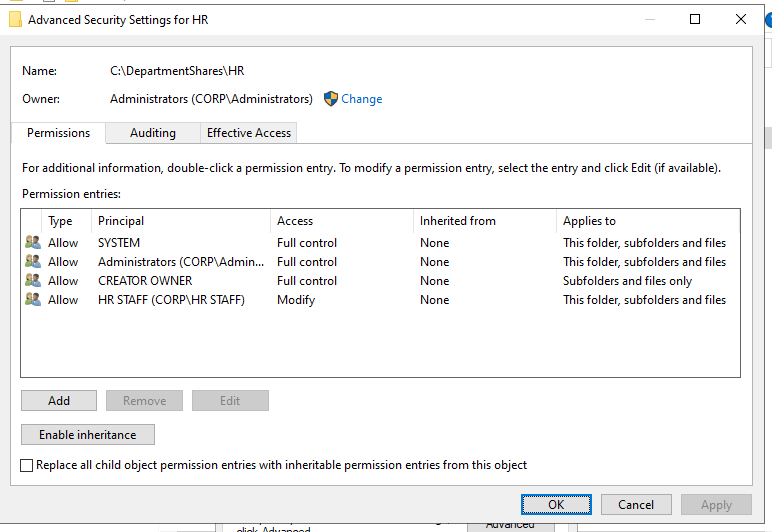
*Figure 2 — HR STAFF permissions on the HR folder.*

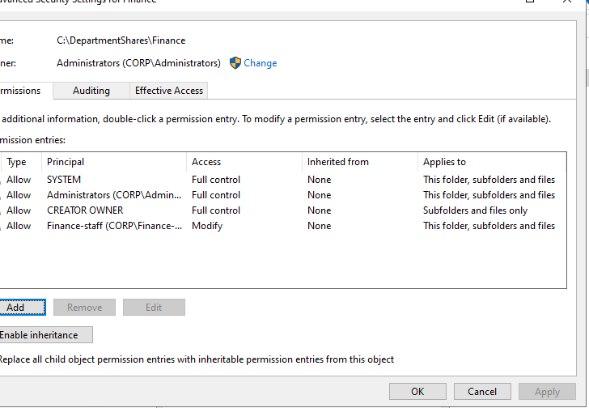
*Figure 3 — Finance-staff permissions on the Finance folder.*

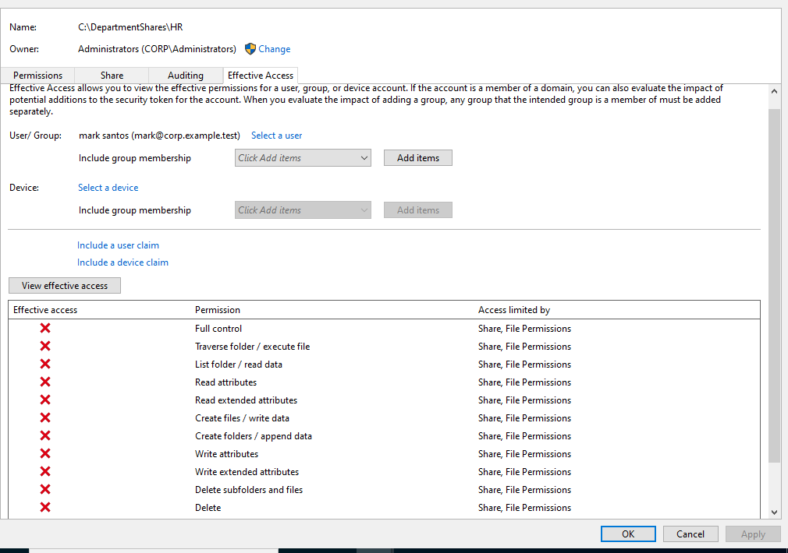
*Figure 4 — Effective Access assessment showing Mark's restricted HR permissions.*

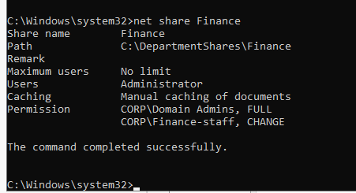
*Figure 5 — Finance share path and SMB permissions verified using `net share`.*

### Windows Security event evidence

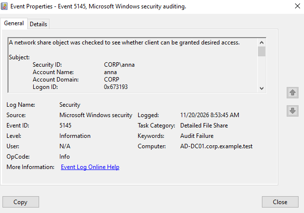
*Figure 6 — Event 5145 identifies the account involved in the access attempt.*

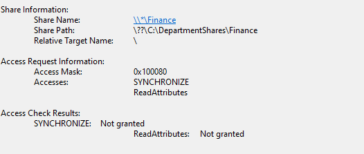
*Figure 7 — Access checks report that the requested permissions were not granted.*

### Wazuh collection and alert verification

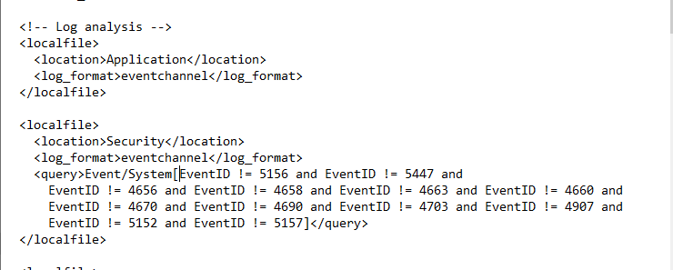
*Figure 8 — The Wazuh agent Security event filter after removing the Event 5145 exclusion.*

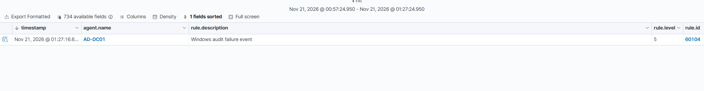
*Figure 9 — Wazuh Threat Hunting displays the audit-failure alert.*

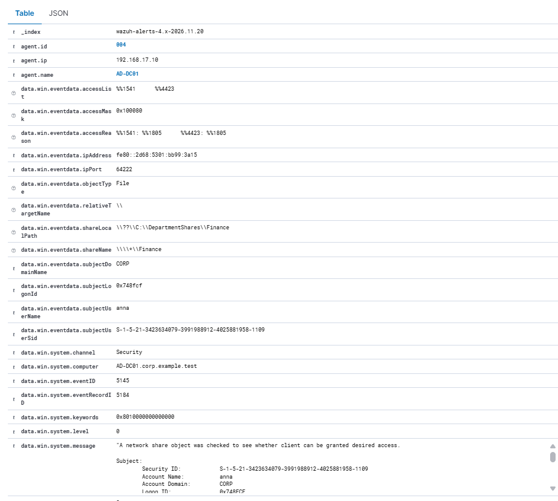
*Figure 10 — Decoded Event 5145 fields identify Anna and the Finance share.*

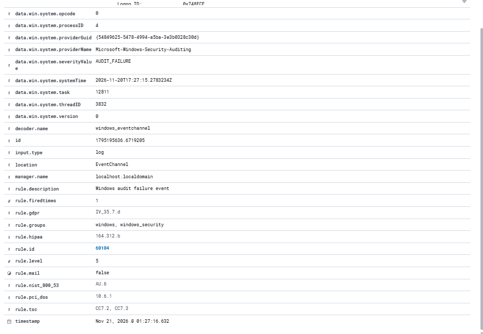
*Figure 11 — Wazuh rule 60104, severity level 5, and audit-failure classification.*

## Conclusion

This isolated lab combined Active Directory RBAC, least-privilege file sharing, Windows auditing, and Wazuh SIEM monitoring. It included practical troubleshooting of an incorrect share path, missing auditing policy, and a Windows event collection exclusion.

**Skills practiced:** Active Directory, RBAC, NTFS permissions, SMB shares, Windows Security auditing, Event ID 5145, Wazuh SIEM, alert triage, and evidence-based troubleshooting.

---

*All activity was performed in an authorized home-lab environment for cybersecurity learning and portfolio development.*
